# My Social Networks API

API REST de gestion d'événements, de groupes, de fils de discussion, d'albums photo, de sondages, de billetterie, de shopping list et de covoiturage (TP « My Social Networks API »).

>
> (procédure de publication en bas de ce document, section [Documentation Postman](#documentation-postman))

## Sommaire

1. [Stack](#stack)
2. [Prérequis](#prérequis)
3. [Installation](#installation)
4. [Architecture du projet](#architecture-du-projet)
5. [Modèles et relations](#modèles-et-relations)
6. [Format des réponses, erreurs et pagination](#format-des-réponses-erreurs-et-pagination)
7. [Récapitulatif des endpoints](#récapitulatif-des-endpoints)
8. [Règles métier et implémentation](#règles-métier-et-implémentation)
9. [Choix techniques](#choix-techniques)
10. [Tests](#tests)
11. [Documentation Postman](#documentation-postman)

## Stack

- Node.js (LTS) + Express 5
- MongoDB + Mongoose 9 (règles d'unicité et de validation dans les schémas **et** dans la logique métier)
- JWT (`jsonwebtoken`) + `bcrypt` pour les mots de passe
- `joi` pour la validation des entrées
- `dotenv` pour la configuration

## Prérequis

- Node.js 20 ou plus
- MongoDB en local (`mongodb://127.0.0.1:27017`) ou une URI MongoDB Atlas
- (pour la documentation) l'application Postman

## Installation

```bash
git clone <url-du-depot>
cd <dossier-du-depot>

npm install
cp .env.example .env        # puis adapter les valeurs (JWT_SECRET, MONGODB_URI...)
npm run seed                # vide la base et insère les données de démonstration
npm run dev                 # démarre l'API avec rechargement auto (npm start sans rechargement)
```

L'API écoute sur `http://localhost:3000/api/v1` (voir `GET /api/v1/health`).

Variables d'environnement (`.env.example`) :

| Variable | Rôle | Défaut |
| --- | --- | --- |
| `PORT` | port HTTP | `3000` |
| `MONGODB_URI` | connexion MongoDB | `mongodb://127.0.0.1:27017/mysocialnetworks` |
| `JWT_SECRET` | secret de signature des tokens | à changer |
| `JWT_EXPIRES_IN` | durée de validité des tokens | `7d` |
| `BCRYPT_ROUNDS` | coût du hash des mots de passe | `10` |
| `PUBLIC_URL` | base des liens de partage d'un événement | `http://localhost:3000` |

### Données de démo (`npm run seed`)

Le script **vide la base** puis insère : 8 utilisateurs, 3 groupes (public, privé, secret), 4 événements (publics et privés), des fils de discussion avec messages et commentaires, un album avec photos, un sondage avec votes, une billetterie (dont un type de billet épuisé), une shopping list et des offres de covoiturage. Il affiche en console les identifiants de connexion.

Mot de passe de **tous** les comptes : `Password123!`

| Email | Rôle dans la démo |
| --- | --- |
| `alice.martin@example.com` | admin des 3 groupes, organisatrice (sortie photo, anniversaire, réunion) |
| `bruno.durand@example.com` | membre / participant |
| `claire.bernard@example.com` | organisatrice de la sortie photo |
| `david.moreau@example.com` | organisateur du Festival Jazz (billetterie) |
| `emma.petit@example.com`, `farid.benali@example.com`, `gwen.leroy@example.com` | membres / participants |
| `hugo.simon@example.com` | aucun groupe ni événement (utilisateur « extérieur ») |

## Architecture du projet

```
src/
  app.js            application Express (middlewares, routes, gestion d'erreurs)
  server.js         connexion MongoDB + démarrage
  seed.js           données de démonstration (npm run seed)
  config/           variables d'environnement, connexion à la base
  models/           schémas Mongoose (règles d'unicité et de validation)
  validators/       schémas Joi (validation des corps de requêtes)
  middlewares/      auth JWT, validation, contrôle des ids, erreurs centralisées
  services/         droits (access, context), cascade de suppression, partage, utilisateurs
  controllers/      logique métier de chaque ressource
  routes/           déclaration des endpoints (préfixe /api/v1)
  utils/            AppError, réponses, pagination / tri / filtres
postman/            collection + environnement Postman
test/               vérification automatisée des règles métier
```

## Modèles et relations

```mermaid
erDiagram
    USER {
        string firstname
        string lastname
        string email UK
        string password "hashé, jamais renvoyé"
        string avatar
        date birthdate
        object address
    }
    GROUP {
        string name
        string description
        string icon
        string coverPhoto
        enum type "public | private | secret"
        bool allowMembersToPost
        bool allowMembersToCreateEvents
    }
    EVENT {
        string name
        string description
        date startDate
        date endDate "> startDate"
        string location
        string coverPhoto
        enum visibility "public | private"
        bool ticketingEnabled
        bool shoppingListEnabled
        bool carpoolEnabled
    }
    THREAD {
        string title
        ref group "XOR event"
        ref event "XOR group"
    }
    MESSAGE {
        string content
    }
    COMMENT {
        string content
        ref message "XOR photo"
        ref photo "XOR message"
    }
    ALBUM {
        string title
        string description
    }
    PHOTO {
        string url
        string caption
    }
    POLL {
        string title
        array questions "1..n, chacune avec 2..n réponses"
    }
    VOTE {
        ref question
        ref answer
    }
    TICKETTYPE {
        string name
        number amount
        number quantity
        number sold
    }
    TICKET {
        object buyer "nom, prénom, email, adresse"
        date purchaseDate
    }
    SHOPPINGITEM {
        string name
        string nameNormalized "unique par événement"
        number quantity
        date arrivalTime
    }
    CARPOOLOFFER {
        string departurePlace
        date departureTime
        number price
        number availableSeats
        number maxDetourMinutes
    }

    USER }o--o{ GROUP : "admins (1..n) / members (1..n)"
    USER }o--o{ EVENT : "organizers (1..n) / participants (0..n)"
    GROUP |o--o{ EVENT : "group (optionnel)"
    GROUP |o--o{ THREAD : "1 groupe"
    EVENT |o--o{ THREAD : "ou 1 événement"
    THREAD ||--o{ MESSAGE : "0..n"
    USER ||--o{ MESSAGE : "auteur"
    MESSAGE ||--o{ COMMENT : "0..n"
    PHOTO ||--o{ COMMENT : "0..n"
    USER ||--o{ COMMENT : "auteur"
    EVENT ||--o{ ALBUM : "0..n"
    ALBUM ||--o{ PHOTO : "0..n"
    USER ||--o{ PHOTO : "posté par un participant"
    EVENT ||--o{ POLL : "0..n (organisateur)"
    POLL ||--o{ VOTE : "unique (poll, question, user)"
    USER ||--o{ VOTE : "vote"
    EVENT ||--o{ TICKETTYPE : "1..n (public + ticketingEnabled)"
    TICKETTYPE ||--o{ TICKET : "stock décrémenté atomiquement"
    EVENT ||--o{ TICKET : "unique (event, email)"
    EVENT ||--o{ SHOPPINGITEM : "unique (event, nom normalisé)"
    USER ||--o{ SHOPPINGITEM : "apporte"
    EVENT ||--o{ CARPOOLOFFER : "0..n"
    USER ||--o{ CARPOOLOFFER : "conducteur"
```



Les questions et réponses d'un sondage sont des sous-documents du sondage ; les passagers d'une offre de covoiturage sont un tableau de références vers les utilisateurs.

## Format des réponses, erreurs et pagination

Succès :

```json
{ "success": true, "data": { "...": "..." }, "meta": { "page": 1, "limit": 20, "total": 42, "pages": 3 } }
```

(`meta` n'existe que pour les listes paginées ; `204 No Content` n'a pas de corps.)

Erreur :

```json
{ "success": false, "error": { "code": "TICKET_ALREADY_BOUGHT", "message": "Une personne ne peut obtenir qu'un seul billet par événement" } }
```

| Code HTTP | Utilisation |
| --- | --- |
| 200 / 201 / 204 | succès / création / suppression |
| 400 | requête invalide : identifiant mal formé, tri ou date invalide, règle simple non respectée |
| 401 | token absent, invalide ou expiré ; identifiants de connexion incorrects |
| 403 | droits insuffisants (non admin, non organisateur, non membre, fonctionnalité désactivée...) |
| 404 | ressource introuvable (ou invisible : groupe secret pour un non-membre) |
| 409 | conflit : unicité (email, billet, élément de shopping list), stock épuisé, dernier admin/organisateur... |
| 422 | données invalides (validation Joi ou Mongoose : dates incohérentes, champ manquant...) |

**Listes (le « S » de CRUDS)** : toutes les routes de liste acceptent `page` (défaut 1), `limit` (défaut 20, max 100), `sort` (ex. `sort=-createdAt` ; champs autorisés propres à chaque ressource, sinon 400) et des filtres (`q` pour la recherche texte, `type`, `visibility`, `group`, `event`, `from` / `to` pour les dates...). Les filtres de chaque route sont détaillés dans la collection Postman.

## Récapitulatif des endpoints

Préfixe : `/api/v1`. Sauf mention contraire, toutes les routes exigent `Authorization: Bearer <token>`.

Légende des rôles : **Public** = sans token · **Connecté** = tout utilisateur authentifié · **Admin** = administrateur du groupe · **Membre** = membre du groupe · **Orga** = organisateur de l'événement · **Participant** = participant **ou** organisateur de l'événement.

### Auth et santé

| Méthode | URL | Rôle requis | Description |
| --- | --- | --- | --- |
| GET | `/health` | Public | Vérifie que l'API répond |
| POST | `/auth/register` | Public | Crée un compte (409 si l'email existe) et renvoie un JWT |
| POST | `/auth/login` | Public | Connexion, renvoie le profil et un JWT |

### Utilisateurs

| Méthode | URL | Rôle requis | Description |
| --- | --- | --- | --- |
| GET | `/users` | Connecté | Recherche paginée (`q`, `city`, tri) : profils publics |
| GET | `/users/me` | Connecté | Mon profil complet |
| GET | `/users/:id` | Connecté | Profil d'un utilisateur (public, complet pour soi) |
| PATCH | `/users/:id` | Propriétaire du compte | Modifie son compte |
| DELETE | `/users/:id` | Propriétaire du compte | Supprime son compte (409 si dernier admin/organisateur) |

### Groupes

| Méthode | URL | Rôle requis | Description |
| --- | --- | --- | --- |
| POST | `/groups` | Connecté | Crée un groupe (le créateur est admin et membre) |
| GET | `/groups` | Connecté | Recherche (`q`, `type`, `mine`) ; les groupes secrets sont invisibles aux non-membres |
| GET | `/groups/:id` | Connecté | Détail (résumé pour un non-membre d'un groupe privé, 404 si secret) |
| PATCH | `/groups/:id` | Admin | Modifie les paramètres du groupe |
| DELETE | `/groups/:id` | Admin | Supprime le groupe et ses fils |
| POST | `/groups/:id/join` | Connecté | Rejoint un groupe public |
| POST | `/groups/:id/leave` | Membre | Quitte le groupe (409 si dernier admin) |
| POST | `/groups/:id/members` | Admin | Ajoute un membre |
| DELETE | `/groups/:id/members/:userId` | Admin (ou soi-même) | Retire un membre |
| POST | `/groups/:id/admins` | Admin | Nomme un membre administrateur |
| DELETE | `/groups/:id/admins/:userId` | Admin | Retire un admin (409 si le dernier) |

### Événements

| Méthode | URL | Rôle requis | Description |
| --- | --- | --- | --- |
| POST | `/events` | Connecté (membre du groupe si `group`) | Étape 1 : crée l'événement ; `inviteGroupMembers` invite tout le groupe |
| GET | `/events` | Connecté | Recherche (`q`, `visibility`, `group`, `mine`, `role`, `from`, `to`) : publics + les miens |
| GET | `/events/:id` | Connecté (participant si privé) | Détail |
| PATCH | `/events/:id` | Orga | Modifie l'événement et ses options |
| DELETE | `/events/:id` | Orga | Supprime l'événement et toutes ses données |
| POST | `/events/:id/organizers` | Orga | Ajoute un organisateur |
| DELETE | `/events/:id/organizers/:userId` | Orga | Retire un organisateur (409 si le dernier) |
| POST | `/events/:id/participants` | Orga | Invite un ou plusieurs participants |
| DELETE | `/events/:id/participants/:userId` | Orga (ou soi-même) | Retire un participant |
| POST | `/events/:id/join` | Connecté | Rejoint un événement public |
| POST | `/events/:id/leave` | Participant | Quitte l'événement |
| POST | `/events/:id/invite-group-members` | Orga | Invite tous les membres du groupe de l'événement |
| GET | `/events/:id/share` | Orga | Liens de partage Facebook / X / LinkedIn / WhatsApp (événement et groupe publics) |

### Fils de discussion, messages, commentaires

| Méthode | URL | Rôle requis | Description |
| --- | --- | --- | --- |
| POST | `/threads` | Membre/Admin ou Participant | Crée un fil lié à `group` **XOR** `event` |
| GET | `/threads` | Connecté | Recherche (`group`, `event`, `q`) parmi les fils accessibles |
| GET | `/threads/:id` | Membre / Participant | Détail |
| PATCH | `/threads/:id` | Créateur, Admin ou Orga | Renomme le fil |
| DELETE | `/threads/:id` | Créateur, Admin ou Orga | Supprime le fil, ses messages et commentaires |
| GET | `/threads/:id/messages` | Membre / Participant | Messages du fil (`q`, `author`, `from`, `to`) |
| POST | `/threads/:id/messages` | Membre/Admin ou Participant (`allowMembersToPost`) | Publie un message |
| GET | `/messages/:id` | Membre / Participant | Détail d'un message |
| PATCH | `/messages/:id` | Auteur | Modifie son message |
| DELETE | `/messages/:id` | Auteur, Admin ou Orga | Supprime un message |
| GET | `/messages/:id/comments` | Membre / Participant | Commentaires du message |
| POST | `/messages/:id/comments` | Membre / Participant | Commente un message |
| GET | `/comments/:id` | Membre / Participant | Détail d'un commentaire (message ou photo) |
| PATCH | `/comments/:id` | Auteur | Modifie son commentaire |
| DELETE | `/comments/:id` | Auteur, Admin ou Orga | Supprime un commentaire |

### Albums et photos

| Méthode | URL | Rôle requis | Description |
| --- | --- | --- | --- |
| POST | `/albums` | Participant | Crée l'album d'un événement |
| GET | `/albums` | Connecté | Recherche (`event`, `q`) |
| GET | `/albums/:id` | Connecté (participant si événement privé) | Détail |
| PATCH | `/albums/:id` | Créateur ou Orga | Modifie l'album |
| DELETE | `/albums/:id` | Créateur ou Orga | Supprime l'album, ses photos et leurs commentaires |
| GET | `/albums/:id/photos` | Connecté (participant si privé) | Photos de l'album |
| POST | `/albums/:id/photos` | Participant (403 sinon) | Poste une photo |
| GET | `/photos/:id` | Connecté (participant si privé) | Détail d'une photo |
| PATCH | `/photos/:id` | Auteur de la photo | Modifie la légende / l'URL |
| DELETE | `/photos/:id` | Auteur ou Orga | Supprime la photo |
| GET | `/photos/:id/comments` | Connecté (participant si privé) | Commentaires de la photo |
| POST | `/photos/:id/comments` | Participant | Commente une photo |

### Sondages

| Méthode | URL | Rôle requis | Description |
| --- | --- | --- | --- |
| POST | `/polls` | Orga | Crée un sondage (≥ 1 question, ≥ 2 réponses par question) |
| GET | `/polls` | Connecté | Recherche (`event`, `q`) |
| GET | `/polls/:id` | Connecté (participant si privé) | Détail avec questions et réponses |
| PATCH | `/polls/:id` | Orga | Modifie le titre / les questions (409 si des votes existent) |
| DELETE | `/polls/:id` | Orga | Supprime le sondage et ses votes |
| POST | `/polls/:id/vote` | Participant | Choisit une réponse par question (re-voter remplace) |
| DELETE | `/polls/:id/votes/:questionId` | Participant | Retire son vote |
| GET | `/polls/:id/results` | Connecté (participant si privé) | Décompte des votes par réponse |

### Billetterie

| Méthode | URL | Rôle requis | Description |
| --- | --- | --- | --- |
| POST | `/events/:eventId/ticket-types` | Orga | Crée un type de billet (événement public + `ticketingEnabled`) |
| GET | `/events/:eventId/ticket-types` | Public | Liste des types de billets |
| GET | `/events/:eventId/tickets/remaining` | Public | Billets restants par type |
| GET | `/ticket-types/:id` | Public | Détail d'un type de billet |
| PATCH | `/ticket-types/:id` | Orga | Modifie un type (409 si quantité < vendus) |
| DELETE | `/ticket-types/:id` | Orga | Supprime un type (409 si des billets sont vendus) |
| POST | `/events/:eventId/tickets` | Public | Achète un billet (409 si épuisé ou si l'email a déjà un billet) |
| GET | `/events/:eventId/tickets` | Orga | Liste des billets vendus (`ticketType`, `q`, `from`, `to`) |
| GET | `/tickets/:id` | Orga | Détail d'un billet |
| PATCH | `/tickets/:id` | Orga | Corrige les données de l'acheteur |
| DELETE | `/tickets/:id` | Orga | Annule un billet et rend la place au stock |

### Shopping list

| Méthode | URL | Rôle requis | Description |
| --- | --- | --- | --- |
| POST | `/events/:eventId/shopping-items` | Participant (`shoppingListEnabled`) | Ajoute ce que l'on apporte (409 si le nom existe déjà) |
| GET | `/events/:eventId/shopping-items` | Connecté ayant accès à l'événement | Liste (`q`, `user`, `from`, `to`) |
| GET | `/shopping-items/:id` | idem | Détail |
| PATCH | `/shopping-items/:id` | Propriétaire ou Orga | Modifie un élément |
| DELETE | `/shopping-items/:id` | Propriétaire ou Orga | Supprime un élément |

### Covoiturage (bonus)

| Méthode | URL | Rôle requis | Description |
| --- | --- | --- | --- |
| POST | `/events/:eventId/carpools` | Participant (`carpoolEnabled`) | Propose un trajet |
| GET | `/events/:eventId/carpools` | Connecté ayant accès à l'événement | Liste (`q`, `maxPrice`, `minSeats`, `from`, `to`) |
| GET | `/carpools/:id` | idem | Détail (conducteur, passagers, places restantes) |
| PATCH | `/carpools/:id` | Conducteur ou Orga | Modifie l'offre |
| DELETE | `/carpools/:id` | Conducteur ou Orga | Supprime l'offre |
| POST | `/carpools/:id/book` | Participant (hors conducteur) | Réserve une place (décrément atomique) |
| DELETE | `/carpools/:id/book` | Passager | Annule sa réservation |

## Règles métier et implémentation

| Règle | Implémentation | Réponse |
| --- | --- | --- |
| Deux utilisateurs ne peuvent pas avoir le même email | index unique `email` (lowercase) + vérification dans `register` / `update` | 409 `EMAIL_ALREADY_USED` |
| Le mot de passe est hashé et jamais renvoyé | hook `pre('save')` bcrypt, `select: false` + `toJSON` | - |
| `endDate` > `startDate` | Joi (`greater(ref)`) + hook `pre('validate')` du schéma Event (vérifié aussi sur PATCH) | 422 |
| Un événement a ≥ 1 organisateur ; on ne retire pas le dernier | `pre('validate')` + contrôle dans `removeOrganizer` | 409 `LAST_ORGANIZER` |
| Un groupe a ≥ 1 admin et ≥ 1 membre ; on ne retire pas le dernier admin | `pre('validate')` + contrôles dans `leave`, `removeMember`, `removeAdmin` | 409 `LAST_ADMIN` |
| Le créateur d'un groupe est admin **et** membre | `groupController.create` | - |
| Événement privé visible seulement des organisateurs / participants | filtre de la recherche + `getVisibleEvent` | 403 `EVENT_PRIVATE` |
| Groupe secret invisible pour les non-membres | filtre de la recherche + `getGroup` | 404 |
| Création d'événement dans un groupe : membres autorisés seulement si `allowMembersToCreateEvents`, sinon admins | `eventController.create` | 403 `GROUP_EVENTS_NOT_ALLOWED` |
| Inviter tous les membres du groupe en un clic | `inviteGroupMembers: true` à la création, ou `POST /events/:id/invite-group-members` | - |
| Partage sur les réseaux sociaux (événement/groupe publics) | `GET /events/:id/share` | 403 `SHARE_NOT_ALLOWED` sinon |
| Fil lié à 1 groupe **XOR** 1 événement | Joi (`xor`) + `pre('validate')` du schéma Thread + contrôle dans le contrôleur | 422 |
| Publication dans un groupe : `allowMembersToPost` | `context.requirePoster` | 403 `POSTING_NOT_ALLOWED` |
| Tout membre / participant peut commenter | `context.requireMember` (indépendant de `allowMembersToPost`) | 403 sinon |
| Photo postée par un participant de l'événement | `access.requireEventMember` | 403 `NOT_PARTICIPANT` |
| Sondage créé par un organisateur uniquement | `access.requireOrganizer` | 403 `NOT_ORGANIZER` |
| Sondage : ≥ 1 question, ≥ 2 réponses par question | Joi + validateurs du schéma Poll | 422 |
| Une seule réponse par question et par participant | index unique `(poll, question, user)` + `findOneAndUpdate` en upsert : **re-voter remplace** | 201 (1er vote) puis 200 (remplacement) |
| Billetterie : événements publics avec `ticketingEnabled` | `getTicketingEvent` | 403 `TICKETING_PUBLIC_ONLY` / `FEATURE_DISABLED` |
| 1 seul billet par personne et par événement | index unique `(event, buyer.email)` + pré-vérification | 409 `TICKET_ALREADY_BOUGHT` |
| Pas de survente | `findOneAndUpdate({ sold < quantity }, { $inc: { sold: 1 } })` atomique, remise en stock si la création du billet échoue | 409 `SOLD_OUT` |
| Billets restants par type | `GET /events/:eventId/tickets/remaining` | - |
| Shopping list : active seulement si `shoppingListEnabled` | `requireFeature` | 403 `FEATURE_DISABLED` |
| Élément unique par événement | index unique `(event, nameNormalized)` (minuscules, espaces nettoyés) + pré-vérification | 409 `ITEM_ALREADY_EXISTS` |
| Covoiturage : actif seulement si `carpoolEnabled` | `requireFeature` | 403 `FEATURE_DISABLED` |
| Réservation d'une place | `findOneAndUpdate({ availableSeats > 0, passager absent }, { $inc: -1, $push })` atomique | 409 `NO_SEATS_LEFT` / `ALREADY_BOOKED` |

## Choix techniques

- **Authentification** : JWT (7 jours par défaut) avec `bcrypt`. Pas de rôle global : les droits dépendent de la relation avec la ressource (admin d'un groupe, organisateur ou participant d'un événement).
- **Validation à deux niveaux** : Joi valide les corps de requêtes (422), les schémas Mongoose valident à nouveau (`pre('validate')`) pour que les règles tiennent même si les données arrivent par un autre chemin (seed, PATCH partiel).
- **Visibilité** : un groupe **secret** est invisible (404) pour les non-membres ; un événement **privé** est caché des recherches et renvoie 403 en accès direct. Un groupe **privé** est trouvable et son résumé consultable, mais on ne le rejoint que sur ajout par un admin.
- **Organisateurs et participants** : un organisateur est aussi considéré comme participant pour les droits (publier, voter, poster une photo...). Les deux listes ne se recoupent pas (ajouter un organisateur le retire des participants).
- **Fils de discussion** : accessibles uniquement aux membres du groupe / participants de l'événement. Dans un groupe, la création d'un fil et la publication de messages suivent `allowMembersToPost`.
- **Vote** : re-voter **remplace** la réponse précédente (200) au lieu de renvoyer 409 ; l'index unique garantit qu'il n'y a jamais deux votes pour une même question et un même utilisateur, même avec des requêtes simultanées.
- **Billetterie** : la consultation et l'achat sont publics (une « personne extérieure » n'a pas forcément de compte) ; si l'acheteur envoie un token, le billet est rattaché à son compte. L'unicité repose sur l'email (normalisé en minuscules). Le stock est géré par un compteur `sold` modifié uniquement par des opérations atomiques MongoDB.
- **Dernier admin / organisateur** : refus en 409 (conflit avec l'état de la ressource). Pour la même raison, supprimer son compte est refusé tant qu'on est le dernier admin d'un groupe ou le dernier organisateur d'un événement.
- **Suppressions en cascade** : MongoDB n'a pas de `ON DELETE CASCADE`, le service `cascade.js` supprime les données rattachées (fils, messages, commentaires, albums, photos, sondages, votes, billets, shopping list, covoiturages). Supprimer un groupe ne supprime pas ses événements : ils sont simplement détachés.
- **PATCH** plutôt que PUT pour les modifications partielles ; les adresses sont fusionnées champ par champ.
- **Pagination** : `meta` ajouté à côté de `data` pour les listes (`page`, `limit`, `total`, `pages`).
- **Partage** : `GET /events/:id/share` fabrique les liens à partir de `PUBLIC_URL`.

## Tests

`npm test` lance `test/rules.test.js` : il démarre l'API sur une base dédiée (`mysocialnetworks_test`, supprimée à la fin) et vérifie les règles métier une par une (email dupliqué, fil lié à un groupe ET un événement, double vote, 2e billet pour le même email, élément de shopping list dupliqué, stock épuisé et achats simultanés, retrait du dernier organisateur / admin, `endDate` < `startDate`, etc.). MongoDB doit être démarré.

## Documentation Postman

Fichiers fournis dans `postman/` :

- `MySocialNetworks.postman_collection.json` : collection v2.1, 13 dossiers (Auth, Users, Groups, Events, Threads, Messages, Comments, Albums, Photos, Polls, Tickets, ShoppingList, Carpool). Chaque requête a une URL avec variables (`{{baseUrl}}/api/v1/...`), une description fonctionnelle (rôle du endpoint, règles métier, droits requis), un body d'exemple, des tests sur le code de statut et des exemples de réponses (succès + erreurs métier 400 / 403 / 409 / 422...). L'authentification Bearer `{{token}}` est héritée au niveau de la collection.
- `MySocialNetworks.postman_environment.json` : `baseUrl = http://localhost:3000`, tokens et variables d'identifiants.

### Utiliser la collection

1. `npm run seed` puis `npm run dev`.
2. Postman → **Import** → sélectionner les deux fichiers du dossier `postman/`.
3. Choisir l'environnement **My Social Networks - Local** (en haut à droite).
4. Exécuter `Auth > Login (Alice)`, `Login (Bruno)` et `Login (Hugo)` : les scripts de test enregistrent `{{token}}`, `{{tokenBruno}}` et `{{tokenHugo}}`.
5. Parcourir les dossiers de haut en bas (ou lancer la collection entière avec le *Collection Runner*) : les identifiants créés (`{{groupId}}`, `{{eventId}}`, ...) sont enregistrés automatiquement par les scripts de test et réutilisés par les requêtes suivantes. Pour rejouer la collection depuis le début, relancer `npm run seed`.

### Publier la documentation

1. Dans Postman, ouvrir la collection **My Social Networks API**.
2. Cliquer sur **View documentation** (ou sur `...` → *View documentation*).
3. Cliquer sur **Publish** (en haut à droite), choisir l'environnement **My Social Networks - Local**, régler la mise en forme si besoin, puis **Publish**.
4. Copier l'URL publique obtenue et la coller en haut de ce README, à la place de `<URL À COMPLÉTER>`.
5. Commit et push : `git add README.md && git commit -m "docs: url de la documentation Postman" && git push`.
